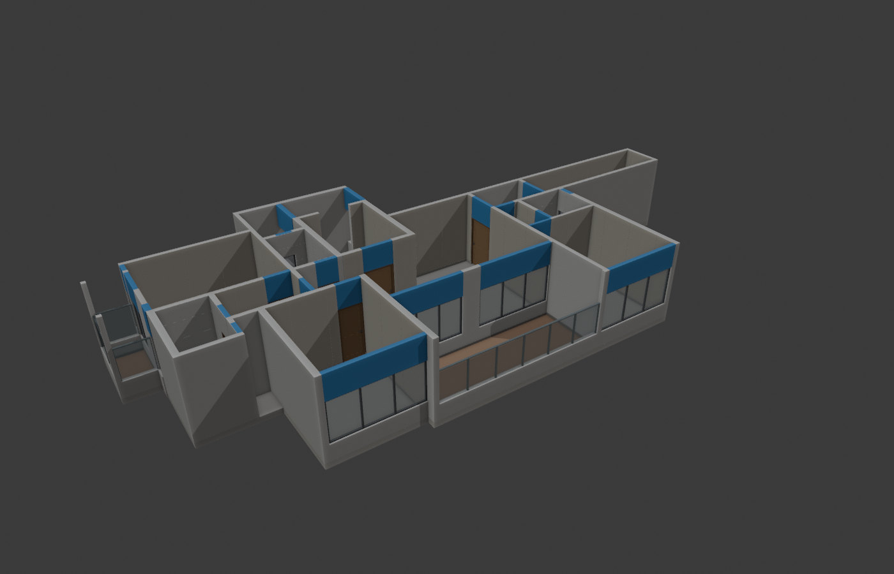
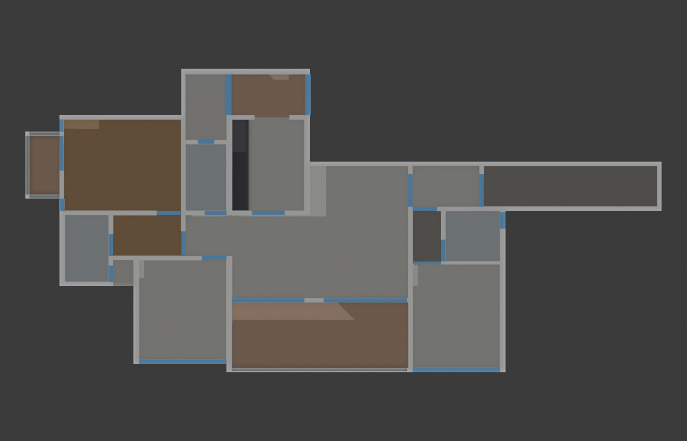
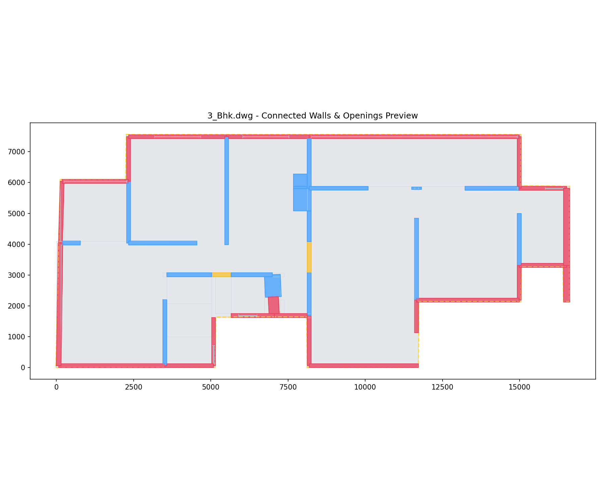
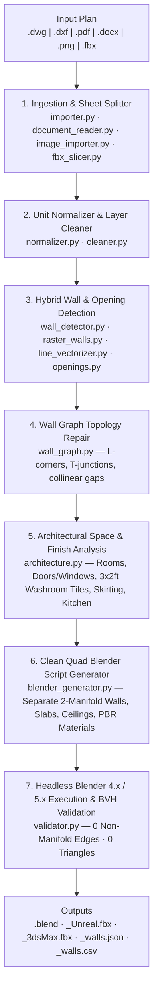

# CAD-BLENDER-UNREAL (Auto Flat)

[](https://github.com/arhamsancheti/CAD-BLENDER-UNREAL-auto-flat/actions/workflows/ci.yml)
[](https://www.python.org/)
[](https://www.blender.org/)
[](https://www.unrealengine.com/)
[](https://www.autodesk.com/products/3ds-max/)
[](LICENSE)

**CAD-BLENDER-UNREAL (Auto Flat)** is an end-to-end architectural automation pipeline and interactive local web studio that transforms 2D floor plans (`.dwg`, `.dxf`, `.pdf`, Word `.docx`/`.doc`, `.png`/`.jpg`/`.webp`, and 3D `.fbx` plan slices) into **clean, watertight, quad/planar, individually editable 3D apartment ("auto flat") models** for **Blender 4.x/5.x**, **Unreal Engine 5**, and **Autodesk 3ds Max**.



---

## Key Highlights

- **Multi-Format Floor Plan Ingestion**
  - **AutoCAD `.dwg` & `.dxf`**: Out-of-the-box `.dwg` conversion on Windows via bundled `tools/libredwg/dwg2dxf.exe`, block explosion (`INSERT`), multi-sheet cluster splitting, and automatic unit normalization (`mm`, `cm`, `m`, `inch`, `ft`).
  - **PDF & Word Specifications (`.pdf`, `.docx`, `.doc`, `.odt`, `.rtf`)**: Extracts vector CAD drawings, embedded floor plan rasters, room dimensions, ceiling heights, door/window schedules, and finish specifications directly from architectural brochures and spec sheets.
  - **Raster Floor Plans (`.png`, `.jpg`, `.jpeg`, `.webp`, `.bmp`)**: Adaptive morphological + skeletonized line vectorization and modal wall-thickness calibration.
  - **3D Reference / Mesh Slicing (`.fbx`, `.obj`, `.glb`, `.stl`)**: Horizontal section-plane slicing at wall height + multi-reference overlay alignment (`validate`, `calibrate`, or `authoritative` mode).
- **Clean Quad / Planar Mesh Topology (Zero Cross-Segment Triangulation)**
  - **Separate Editable Wall Meshes**: Every wall (`Wall_001`, `Wall_002`, …), corner post, window sill (`Sill_*`), and door/window lintel (`Head_*`) is generated as its own watertight 2-manifold quad prism in `01_Structure > WALLS` and `02_Openings > LINTELS` — ready for instant single-wall selection, UV unwrapping, material assignment, or moving/resizing in Blender, Unreal Engine 5, or 3ds Max.
  - **Orthogonal Hole Decomposition**: Floor slabs and false ceilings with rectangular shafts/cutouts are decomposed into clean orthogonal quads/n-gons with **0 diagonal triangulation lines** in wireframe mode, and exported with `use_triangles=False`.
  - **Smooth Shading on Curved Fixtures**: Door handles, hinges, kitchen faucets, and closed-rim recessed LED downlights use true smooth shading with sharp flat end-caps.
- **Complete Interior & Exterior Architectural Detailing**
  - **Doors & Windows**: Hinged wooden doors (main entrance, bedroom, washroom), multi-track aluminum sliding glass doors/windows, casement windows, washroom louvers/ventilators, and color-coded blue structural lintels (`MAT_Lintel_Blue`).
  - **Room-Specific Flooring**: Wood planks for Master Bedroom (`MAT_Floor_Master_Wood`), vitrified tiles for Living/Dining/Bedrooms (`MAT_Floor_Common`), anti-skid tiles for Washrooms & Balconies, plus recessed floor drops at washrooms/balconies.
  - **Washroom Wall Tiling**: Full-height (`2100 mm`–`3000 mm`) 3 ft × 2 ft (`900 mm × 600 mm`) grooved wall tile grids (`05_Washroom_Tiles`) automatically trimmed around washroom doors and ventilator windows.
  - **Perimeter Skirting, Balconies, Kitchen & Ceilings**: `100 mm` interior skirting runs trimmed at doorways, laminated glass + brushed metal balcony railings (`1050 mm`), granite kitchen counter with stainless-steel sink & upper cabinets, and recessed cove ceilings with warm LED downlights.
- **Interactive Web Studio + One-Click Headless Blender Export**
  - Inspect detected walls, rooms, openings, repair markers, and multi-sheet drawings in browser canvas, manually add/delete walls or override ambiguous gaps, optionally run **Gemini Vision AI Review**, and click **Export 3D** to produce `.blend`, `*_Unreal.fbx`, and `*_3dsMax.fbx` automatically.

| Top-Down 3D Room & Finish Layout | 2D Wall Topology & Opening Verification |
| :---: | :---: |
|  |  |

---

## System Architecture



For a deep dive into every module and geometric invariant, see [docs/ARCHITECTURE.md](docs/ARCHITECTURE.md).

---

## Blender / FBX Scene Hierarchy

Every generated `.blend` and `.fbx` organizes architectural elements into a clean, engine-ready collection hierarchy:

```text
Scene Collection
├── 01_Structure
│   ├── WALLS                  # Separate, editable 2-manifold wall & sill meshes (Wall_001..., Sill_*)
│   ├── FLOOR_SLAB             # Structural base slab
│   └── CEILING                # Main ceiling + recessed cove ceiling + LED downlights
├── 02_Openings
│   ├── LINTELS                # Separate blue lintel beams above doors/windows (Head_*)
│   ├── DOOR_FITTINGS          # Frames, leaves, smooth cylindrical handles & hinges
│   └── WINDOW_FITTINGS        # Mullions, sliding/casement sashes, louvers & glass panes
├── 03_Flooring                # Per-room untriangulated floor slabs (Master Wood, Common, Balcony, Washroom)
├── 04_Skirting                # 100 mm room perimeter skirting boards (doorways cleanly cut)
├── 05_Washroom_Tiles          # 900x600 mm (3ft x 2ft) washroom wall tile grids with opening cutouts
├── 06_Balcony
│   ├── BALCONY_RAILING        # Posts, top/bottom rails & parapet curbs
│   └── BALCONY_GLASS          # Laminated safety glass panels
├── 07_Kitchen                 # L/straight base cabinets, granite slab, sink, faucet & wall cabinets
└── 08_Materials_And_Lighting  # Sun, sky/area fill lights & architectural cameras
```

---

## Installation & Quickstart

### Prerequisites
- **Python 3.10+** (tested on Python 3.11 and 3.12)
- **Blender 4.0+ or 5.x** (optional for 2D inspection/script generation; required for headless `.blend` / `.fbx` 3D model export — e.g. `C:\Program Files\Blender Foundation\Blender 5.1\blender.exe`)
- **Windows / Linux / macOS** (Windows includes bundled `tools/libredwg/dwg2dxf.exe` for native `.dwg` conversion; on Linux/macOS install `libredwg` via `apt`/`brew` for `.dwg` files)

### 1. Clone & Install Dependencies

```bash
git clone https://github.com/arhamsancheti/CAD-BLENDER-UNREAL-auto-flat.git
cd CAD-BLENDER-UNREAL-auto-flat

python -m venv .venv
# Windows PowerShell:
.\.venv\Scripts\Activate.ps1
# Linux / macOS:
# source .venv/bin/activate

pip install -r requirements.txt
```

### 2. Optional Configuration (`config.json`)

Copy `config.example.json` to `config.json` if you want custom Blender executable paths or optional Gemini Vision AI review:

```bash
cp config.example.json config.json
```

```json
{
  "gemini_api_key": "",
  "gemini_model": "gemini-2.5-flash",
  "blender_exe": "C:\\Program Files\\Blender Foundation\\Blender 5.1\\blender.exe"
}
```

> `config.json` is git-ignored so your API keys never leave your machine. You can also set `BLENDER_EXE` or `GEMINI_API_KEY` via environment variables.

### 3. Launch the Local Web Studio

```bash
python app.py
```

Open **http://127.0.0.1:5000** in your browser:
1. Drop any `.dwg`, `.dxf`, `.pdf`, `.docx`, `.png`, or `.fbx` plan (try any file from [`samples/`](samples/)).
2. Inspect detected walls, rooms, washrooms, doors, windows, and topology repair checks in the interactive 2D viewer.
3. Toggle layers, select individual multi-flat sheets, edit walls, or click **Export 3D (Blender + Unreal + 3ds Max)** to build and download the complete 3D flat package.

---

## Command-Line / Python API Usage

### Generate a 3D Blender Script & Architectural JSON Programmatically

```python
from cad_processor.pipeline import CADtoBlenderPipeline

pipeline = CADtoBlenderPipeline()
result = pipeline.process(
    "samples/2BHK_Type_01_Windgates.dwg",
    wall_height=3000.0,       # mm
    default_thickness=200.0,  # mm
)

assert result["ok"], result.get("error")
print(f"Detected {len([w for w in result['walls'] if w.kind == 'wall'])} walls, "
      f"{len(result['architecture']['rooms'])} rooms")

with open("output/2BHK_Windgates_blender.py", "w", encoding="utf-8") as f:
    f.write(result["script"])
```

### Build `.blend`, Unreal `.fbx`, and 3ds Max `.fbx` Headlessly

```powershell
$env:CAD_EXPORT_DIR = "$PWD\output\2BHK_Windgates_3D"
$env:CAD_EXPORT_NAME = "2BHK_Windgates"
& "C:\Program Files\Blender Foundation\Blender 5.1\blender.exe" -b --factory-startup -P output\2BHK_Windgates_blender.py
```

This writes:
- `2BHK_Windgates.blend` — Native Blender 4.x/5.x scene with full collection hierarchy & PBR materials
- `2BHK_Windgates_Unreal.fbx` — Unreal Engine 5 FBX (`1 unit = 1 cm`, `-Y Forward / Z Up`, face-smoothed, untriangulated quads)
- `2BHK_Windgates_3dsMax.fbx` — Autodesk 3ds Max FBX (`Y Up / -Z Forward`, preserve-edge-orientation quads)
- `2BHK_Windgates_IMPORT_NOTES.txt` — Exact import settings checklist

See [docs/UNREAL_3DSMAX_WORKFLOW.md](docs/UNREAL_3DSMAX_WORKFLOW.md) for step-by-step Unreal Engine 5 (Nanite / Lumen / Lightmass) and 3ds Max (V-Ray / Corona) import workflows.

---

## Included Sample Plans & Pre-Built 3D Examples

### [`samples/`](samples/) — Ready-to-Test Floor Plans

| File | Format | Description |
| :--- | :---: | :--- |
| `samples/2BHK_Type_01_Windgates.dwg` / `.dxf` | DWG / DXF | 2BHK residential apartment CAD plan with washroom shafts, kitchen, balcony & furniture blocks |
| `samples/3BHK_Type_01_Windgates.dwg` / `.dxf` | DWG / DXF | 3BHK residential apartment CAD plan with 3 washrooms, balconies & utility area |
| `samples/3_Bhk.dwg` / `.dxf` | DWG / DXF | Clean 3BHK architectural CAD plan (28 walls, 10 rooms, 3 washrooms) |
| `samples/4BHK_FLAT_NO_01.dwg` | DWG | Large 4BHK luxury apartment CAD drawing |
| `samples/KUTUMB_PRIME_LIFE_2BHK_TYPE-1.pdf` | PDF | Architectural brochure PDF floor plan |
| `samples/3BHK_Specification.docx` / `.pdf` | DOCX / PDF | Written room schedule + embedded floor plan specification document |
| `samples/2BHK_Flat.png` / `3BHK_Flat.png` | PNG | Raster architectural floor plans with room text labels |
| `samples/3BHK_Type1_1266SQ.fbx` | FBX | 3D reference model for section slicing & multi-reference validation |

### [`examples/`](examples/) — Ready-to-Open 3D Outputs

Both [`examples/2BHK_Windgates/`](examples/2BHK_Windgates/) and [`examples/3BHK_Windgates/`](examples/3BHK_Windgates/) include pre-generated, manifold-verified outputs:
- `*_blender.py` — Self-contained Blender Python builder script
- `*.blend` — Ready-to-open Blender 5.x scene (`0` non-manifold edges, `0` triangles)
- `*_Unreal.fbx` — Unreal Engine 5 ready FBX
- `*_3dsMax.fbx` — Autodesk 3ds Max ready FBX
- `*_walls.json` & `*_walls.csv` — Structured wall coordinates, thicknesses, lengths, and classifications
- `*_IMPORT_NOTES.txt` — Engine import quick reference

---

## REST API Endpoints (`app.py`)

| Endpoint | Method | Description |
| :--- | :---: | :--- |
| `/` | `GET` | Interactive 2D/3D CAD-to-Blender web studio |
| `/upload` | `POST` | Upload primary plan (`.dwg`, `.dxf`, `.pdf`, `.docx`, `.png`, `.fbx`) + optional `references` |
| `/rescan` | `POST` | Re-run pipeline with updated `wall_height`, `default_thickness`, `conn_tol`, `drawing`, or layer filters |
| `/edit` | `POST` | Remove/add walls manually or resolve uncertain CAD gaps as `close_wall`, `door`, `window`, or `passage` |
| `/add_outer_walls` | `POST` | Construct an orthogonal, gap-free perimeter wall ribbon around open plans |
| `/add_reference` | `POST` | Attach secondary 2D/3D reference files (`validate`, `calibrate`, or `authoritative` mode) |
| `/ai_review` | `POST` | Optional Gemini Vision inspection of detected walls vs. CAD underlay |
| `/export_3d` | `POST` | Run headless Blender to export `.blend`, `*_Unreal.fbx`, and `*_3dsMax.fbx` |
| `/download/<filename>` | `GET` | Download generated `.py`, `.json`, or `.csv` artifacts |
| `/download_3d/<job>/<file>` | `GET` | Download exported `.blend` / `.fbx` 3D files |

---

## Repository Structure

```text
CAD-BLENDER-UNREAL-auto-flat/
├── app.py                        # Flask + Waitress web server & REST API
├── cad_processor/                # 24-module CAD -> 3D architectural engine
│   ├── pipeline.py               # 11-stage orchestrator & 3D overlap resolver
│   ├── importer.py               # DWG/DXF/PDF/SVG/FBX/DOCX unified loader
│   ├── sheet_splitter.py         # Multi-drawing CAD cluster detector & splitter
│   ├── document_reader.py        # PDF & Word (.docx/.doc) plan + spec extractor
│   ├── image_importer.py         # Raster floor plan importer & OCR scale estimator
│   ├── line_vectorizer.py        # Morphological & skeleton line vectorizer
│   ├── fbx_slicer.py             # 3D mesh horizontal section slicer
│   ├── normalizer.py             # Automatic CAD unit detection -> millimeters
│   ├── cleaner.py                # Duplicate/noise filter, snapping & colinear merge
│   ├── wall_detector.py          # Parallel-pair, poly-strip & block wall detector
│   ├── raster_walls.py           # Distance-transform raster wall thickness analyzer
│   ├── wall_graph.py             # L-corner, T-junction & collinear topology repair
│   ├── openings.py               # CAD arc/block & gap door/window detector
│   ├── architecture.py           # Room classification, floors, 3x2ft tiles, skirting & kitchen
│   ├── blender_generator.py      # Clean quad/planar separate-wall Blender 4.x/5.x & FBX generator
│   ├── validator.py              # Headless Blender BVH & topology verification
│   ├── detection_review.py       # 11-check automated QA & visual overlay generator
│   ├── reference.py              # Multi-reference plan/FBX alignment & diff engine
│   ├── segmentation.py           # Floor-area & wall-band segmentation support
│   ├── ai_review.py              # Optional Gemini Vision wall review
│   ├── wall_builder.py           # Polygon construction helpers
│   ├── wall_data.py              # JSON/CSV exporter & exterior/interior classifier
│   └── models.py                 # Core CADEntity, Wall, LayerInfo dataclasses
├── templates/index.html          # Interactive single-page web UI
├── tools/                        # Diagnostic scripts + bundled Windows LibreDWG binaries
├── samples/                      # Curated DWG, DXF, PDF, DOCX, PNG & FBX test plans
├── examples/                     # Pre-built 2BHK & 3BHK .blend, Unreal .fbx & 3ds Max .fbx
├── docs/                         # Architecture & Unreal/3ds Max workflow guides
├── tests/                        # Automated topology, pipeline & headless Blender test suite
├── requirements.txt              # Python package dependencies
├── config.example.json           # Configuration template
└── LICENSE                       # MIT License
```

---

## Automated Testing

Run the full verification suite (synthetic topology repair, multi-format CAD/PNG/FBX pipeline checks, and headless Blender 5.x manifold & zero-triangle mesh audits):

```bash
# Direct detailed runner:
python tests/test_wall_detection_and_connectivity.py

# Or via standard unittest discovery (also run in GitHub Actions CI):
python -m unittest discover -s tests -v
```

---

## License

Released under the [MIT License](LICENSE). Bundled Windows [GNU LibreDWG](https://www.gnu.org/software/libredwg/) binaries in `tools/libredwg/` are distributed under their respective upstream license terms (see `tools/libredwg/README.txt`).
